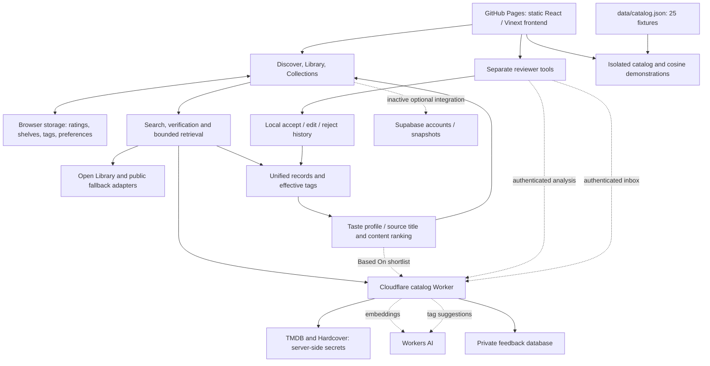

# Architecture

Current source structure; this diagram describes implemented paths, not a fresh live-service verification. [Implementation](IMPLEMENTATION.md) explains ranking; [backend setup](../backend/README.md) explains configuration.

Normal media choices are books, movies and TV. Games/music remain in schema and course fixtures. There is no complete provider-catalog database. The D1 inbox stores submitted feedback, not everyone's library; current public cards no longer submit feedback. AI suggestions stay inactive until reviewed and do not train the model.

The principal modules are `lib/media-api.ts`, `lib/library-storage.ts`, `lib/recommendations.ts`, `lib/ai-tagging.ts`, `backend/` and `components/`. `.github/workflows/pages.yml` builds the frontend; the Worker deploys separately. Legacy `/milestones/` and `/week8/` routes and evidence directories retain their names to keep recorded demonstrations reproducible.
